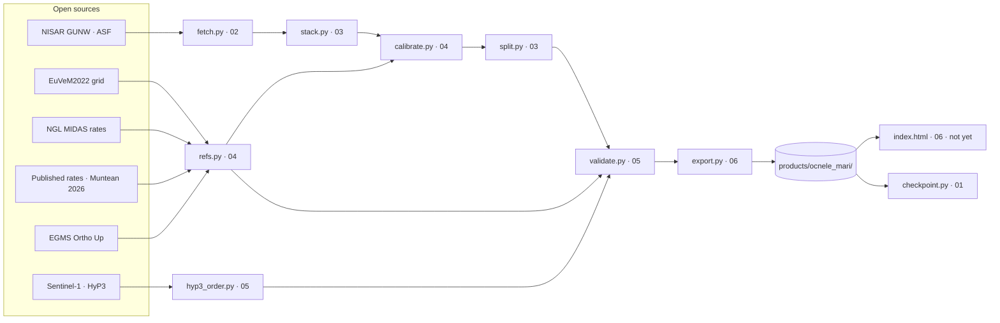

# BUILD.md · Dancing on Salt

> The team's build plan for **NASA Space Apps 2026 · Dancing with the SARs** (Saturday 14 – Sunday 15 November 2026).
>
> **Status: skeleton.** Only the decisions under [Locked](docs/decisions.md#locked) are final. Anything marked
> **DRAFT** is a starting proposal that its owner confirms or changes. Anything marked **OPEN** needs a team decision,
> recorded in [docs/decisions.md](docs/decisions.md).

---

## 1. What we are building

We're building one static web page that shows how the ground moves at **Ocnele Mari** (Vâlcea county). Brine extraction from the salt deposits there has caused cavern collapses and subsidence: Țeica/Socon since 2001, Câmpul II de sonde in 2001 and Câmpul I in 2009 (see [INFO.md](INFO.md)).

- **Measurement:** NISAR L-band radar (NASA–ISRO), as geocoded unwrapped interferograms (GUNW).
- **Reference frame:** open GNSS velocity models put the radar in a real frame, the way EGMS calibrates its own product.
- **Checks:** held-out GNSS stations, EGMS Ortho history, Sentinel-1 over the same months and a synthetic known-answer stack.
- **Page:** a map, a time slider, honest station pins and story stops, readable on a phone.

**The brief, decoded:**

- **Must:** use NISAR data to show surface change.
- **For:** a broad audience.
- **As:** an interactive, open-source app.
- **AI:** allowed, but how we used it must be declared ([docs/ai-use.md](docs/ai-use.md)).

## 2. Locked decisions

| ID | Decision |
|---|---|
| D-001 | **Ocnele Mari is the only site of analysis.** Praid and Slănic, which appear in the advisor deck and kit, are out of scope. |
| D-002 | **The map opens zoomed on the Ocnele Mari area** (Google Maps view `45.086281, 24.2704806`, zoom 13). Zooming out shows Romania, deliberately blurred and de-emphasised, as context only. |

## 3. What we know going in

The advisor ran the whole pipeline on real NISAR data over Ocnele Mari on 12 November 2026 (the rehearsal kit; see [docs/prior-work.md](docs/prior-work.md)). We re-checked the data inventory against NASA CMR on 14 November 2026. Everything below is a **finding to build on, not a result of ours**.

| Topic | What is known | Consequence for us |
|---|---|---|
| NISAR coverage | 22 GUNW pairs over the town. **129A ascending:** 13 pairs from 7 Nov 2025 to 21 Oct 2026, with **no acquisitions from 18 Jan to 23 Jun 2026**. **094D descending:** 9 pairs, 20 Jun to 18 Oct 2026 only. CMR collections: `NISAR_L2_GUNW_BETA_V1` (4 pairs) and `NISAR_L2_GUNW_PROVISIONAL_V1` (18). `NISAR_L2_GUNW_V1` (validated) is empty. | It is "a winter window and a summer–autumn window", not "a year". Ascending and descending overlap only from June to October 2026. |
| Product status | Beta / provisional: "not intended for scientific research". | Say so on the page and in the video. |
| How fast the ground moves | EGMS 2019–2024: at most about **−25 mm/yr**, with salt-zone medians of −0.4 to −10 mm/yr. The deck's "−250 mm/yr" was a factor-10 error (corrected in deck v10; older PDFs still show it). | **Never quote −250 mm/yr.** |
| Noise | Rehearsal per-pixel scatter on stable ground, after the troposphere correction: **37 mm/yr (129A) and 51 mm/yr (094D)**. | Per-pixel rates do not beat their error. Compare **zones, not pixels**. |
| Track agreement | Salt-zone line-of-sight medians: −4.6 mm/yr (129A) against +27.5 mm/yr (094D). | The phase sign is **not confirmed on real data**. |
| EGMS, stable ground | NISAR up − EGMS up: +34 mm/yr before the troposphere correction, +6.4 after, with 27 mm/yr scatter. | The troposphere step matters. Check it. |
| Closure (12 + 12 against 24 days) | **0 triplets.** The 24-day pairs replace missing 12-day pairs. | Either form extra pairs from GSLC or drop the check and say so. |
| Streaming | About 58 MB per pair; 22 pairs in 28 min on a home line with 6 workers. | The hour-6 cut line is probably not needed. Test the venue Wi-Fi early. |
| Stations | VLC1 (NGL, data to 2018) and HORE (NGL, to 2020) are in the window. VLC2 and HORE published rates (Muntean et al. 2026) have no vertical yet. **No ROMPOS data.** | Few stations, all old. The tolerance and the screening matter. |
| Rehearsal verdict | The pipeline works end to end. Ocnele Mari's subsidence is **below what NISAR's first months resolve per pixel**. | The story framing is **OPEN (O-01)**. |

## 4. Architecture



**Rules:**

- No server and no database. The page is static (GitHub Pages) and reads `products/` and nothing else.
- Raw and intermediate data stay in `data/`, which git ignores. Tokens and passwords never enter git.
- Every script has **one owner**. The validator never edits the science scripts, and nobody else edits `validate.py`.
- Third-party data are **linked and credited, not redistributed**. This matters most for the Muntean et al. 2026 supplement table and the EGMS tiles.
- **Numbers freeze at hour 40.**

## 5. The pipeline

Every script is a **stub**: its docstring and command line define the inputs and outputs, and its functions raise `NotImplementedError` until the owner builds them.

| Step | Script | Owner | In → out |
|---|---|---|---|
| References | `refs.py` | 04 | EuVeM2022, NGL MIDAS, published rates and the EGMS Up file → `data/work/<site>/refs/` |
| Fetch | `fetch.py` | 02 | ASF search; stream the site window out of each GUNW (phase − ionosphere, coherence, mask, LOS vectors, DEM) → `data/work/<site>/<track>/` |
| Time series | `stack.py` | 03 | Pairs → displacement per date → rate ± σ, closure → `<track>/ts.npz` |
| Tie | `calibrate.py` | 04 | Model → LOS; NISAR − model on stable ground; stations held out → `<track>/cal.npz`, `products/<site>/calib.json` |
| Up / east | `split.py` | 03 | Ascending + descending → vertical and east–west → `up_east.npz` |
| Second radar | `hyp3_order.py` | 05 | Order Sentinel-1 pairs for the same months (queues for hours: **hour 0**) |
| Checks | `validate.py` | 05 | Sign, stations, tie, closure, gaps, EGMS, synthetic truth → `checks.json`, `checks.md`, `stations.geojson` |
| Export | `export.py` | 06 | PNG overlays, slider frames, series, GeoTIFFs, manifest → `products/<site>/` |
| Mock products | `mock_products.py` | 06 | Writes an invented `products/mock/` in the contract's shape so the page can start before real numbers exist (**works now**) |
| Checkpoint | `checkpoint.py` | 01 | Is `products/<site>/` complete? Lists WARN/FAIL; exits 1 if the page would break (**works now**) |
| Everything | `run_all.py` | shared | Runs the steps in order; `--from <step>`; stops cleanly at the first stub (**works now**) |
| Smoke test | `test_skeleton.py` | everyone | Every script answers `--help`; mock products pass the checkpoint (**works now**) |

## 6. The products contract (DRAFT)

The page reads only `products/<site>/`:

- `manifest.json`
- `up.png`, `east.png`, `los_<track>.png`
- `frames/<track>/<date>.png`
- `series.json`, `stations.geojson`, `checks.json`, `checks.md`, `calib.json`
- `up.tif`, `east.tif`
- `products/index.json`, which lists the sites

The field-level detail is in [docs/contract.md](docs/contract.md). The draft follows the advisor kit's contract, plus a `view` block for D-002. **The Lead (01) and the app developer (06) freeze it at hour 2.** After that, any change goes into the page and `checkpoint.py` in the same PR.

## 7. Team and ownership

| # | Role | Who | Owns |
|---|---|---|---|
| 01 | Lead & story | Mario | `checkpoint.py`, `README.md`, `BUILD.md`, `docs/story.md`, `docs/decisions.md`, `docs/submission.md`, video, project page |
| 02 | NISAR data | Alexandru & Eric | `fetch.py` |
| 03 | InSAR analyst | Alexandru & Eric | `stack.py`, `split.py` |
| 04 | Geodesist | Matei | `refs.py`, `calibrate.py` |
| 05 | Validator | Paul | `validate.py`, `hyp3_order.py`, `docs/validation-log.md` |
| 06 | App developer | Darius | `export.py`, `mock_products.py`, `index.html` and app assets (not created yet) |
| — | shared | everyone | `common.py` (announce changes; the Lead approves), `run_all.py`, `test_skeleton.py`, `requirements.txt`, `docs/ai-use.md`, `docs/prior-work.md` |

The roles do not overlap. Each person's run sheet is in [roles/](roles/). Alexandru and Eric split 02 and 03 between them as they see fit.

## 8. The 48 hours (DRAFT: each owner adjusts their own row)

**Hour 0 = `____-__-__ __:__` local time** (the Lead fills this in). Freeze = hour 40. Submit before the event closes.

| Role | 0–6 | 6–18 | 18–30 | 30–40 | 40–48 |
|---|---|---|---|---|---|
| 01 Lead | Repository; read the 13 Nov guide aloud (prior work, format, judging); **freeze the contract at hour 2** with 06; Earthdata logins for everyone; `story.md` draft; first 10 s of the video | **Checkpoint at hour 12**; video script | **Checkpoint at hour 24**; rough cut | Write-up, credits, AI-use note, prior work | **Freeze**; final video; project page; submit |
| 02 NISAR data | Earthdata token; `fetch.py --list`; streaming test on the venue Wi-Fi; both tracks on disk; one pair shown to the team | Mask, ionosphere and coherence QA per pair; *(former Praid slot, free)* | GSLC pairs for closure, if the team keeps that check (O-07) | Slider frame sizes with 06 | Captions, support |
| 03 InSAR | Read the pipeline end to end; look at the first real pairs | `stack.py`: first rate map; sign check; gaps; pair lengths | `split.py` up/east; closure if the pairs exist; *(former Praid slot, free)* | Uncertainty: grey out \|rate\| < 2σ; zone medians; **freeze at hour 40** | Captions, support |
| 04 Geodesist | `refs.py`: EuVeM2022, NGL MIDAS, Muntean Table S3 (VLC2/HORE vertical) | `calibrate.py`: first tie; offset or plane | Second model (EGMS GNSS model) as the model swap; EGMS stable-ground cross-check with 05 | Final tie; the frame paragraph for the write-up | Captions, support |
| 05 Validator | **Hour 0–1: order Sentinel-1 on HyP3**; EGMS L3 Up 2020–2024 tile; screen the stations | Sentinel-1 rate over the bowl, same months | `validate.py`; explain every WARN | Agree flags; red-team the map with the advisor | **Re-run every check on the frozen build** |
| 06 App | `mock_products.py` → page skeleton on mocks; GitHub Pages; contract with 01 | Map (D-002), slider, legend, units, synthetic banner; real rates as they land | Pins, story mode, phone layout, keyboard use, colour-blind check; honest gap in the slider | Captions, accessibility, demo link | Final polish (no numbers) |

**Checkpoints at hours 2, 12, 24 and 40:**

1. Run `python checkpoint.py ocnele_mari`.
2. Read every WARN and FAIL aloud.
3. Give each one an owner and a verdict: fix, cut or explain.

The advisor red-teams at hours 12, 24 and 40.

## 9. Cut lines (agreed before the clock starts, never reopened)

| By hour | If this is not working | Then |
|---|---|---|
| 6 | Streaming windows out of GUNW | Download one track in full |
| 14 | The time-series inversion | Show the cumulative sum of the 12-day pairs, labelled as such |
| 20 | The velocity-model tie | One constant per track on EGMS stable ground; say so |
| 30 | ~~The second site~~ | Not applicable (D-001); that time goes into Ocnele Mari |
| 36 | The interactive app | A static story map plus a recorded walk-through |
| 40 | Anything that changes numbers | Freeze; after this only text, captions, styling and video |

## 10. Science guardrails

The full reasoning is in [docs/science-notes.md](docs/science-notes.md).

1. **Never show a rate as a number where |rate| < 2σ.** σ is a lower bound (it assumes independent dates), so grey those pixels out.
2. **Compare zones, not pixels.** Use medians over the salt zones against medians over stable ground.
3. **A year is not a rate.** With less than 1.5 years of data, fit no annual term. We have two windows, so say "winter + summer–autumn".
4. **Fit the rate through the dates, not through the pairs.** Pairs share dates, so each date's atmosphere would count many times.
5. **Stations can lie.** HAR1's mast swings 38 mm a year. Screen every station first, and keep them out of the tie (1 km).
6. **Short pairs can bias rates.** In a Sentinel-1 stack, 8-day pairs read 20–40 % higher than 16-day pairs. Test it with closure, or declare it untested.
7. **Check the phase sign; don't assume it.** The salt zones must sink on every track.
8. **Use one reference frame (Eurasia-fixed)** for the model, the stations and the tie.
9. **Beta / provisional products:** say so.
10. **Say "possible, not proven"** where the data cannot decide.
11. **Simple models first.** Any ML must beat a simple baseline out of sample. In an earlier study an LSTM lost to a seasonal model: 6.6 mm against 5.4 mm error.
12. **No ROMPOS data**, and nothing derived from it, anywhere.

## 11. Definition of done

- Each role's "done when" is in its run sheet in [roles/](roles/).
- The submission checklist (8 required items plus the judging criteria) is in [docs/submission.md](docs/submission.md).
- The frozen build passes `python checkpoint.py ocnele_mari` with the contract OK, and every WARN or FAIL is explained in `checks.md` or on the page.

## 12. Open decisions

Owners and options are in [docs/decisions.md](docs/decisions.md). The big ones:

- **O-01:** the story framing at Ocnele Mari, given the rehearsal verdict.
- **O-02:** does the 13 Nov guide allow the advisor kit as prior work?
- **O-03:** adopt the kit's code, or build our own and use the kit as a reference?
- **O-04:** hour 0.
- **O-05:** MintPy, or our own small-baseline inversion?
- **O-06:** the second velocity model.
- **O-07:** GSLC closure pairs, or drop the closure check?
- **O-08:** is there an ML/AI component (02/03), and how is it tested?
- **O-09:** the basemap and how Romania is blurred.

## 13. How to run

```bash
pip install -r requirements.txt          # Python ≥ 3.11
python test_skeleton.py                  # must print "ok:" before any push
python mock_products.py                  # invented products/mock/ for building the page
python checkpoint.py mock                # contract check (any site folder in products/)
python run_all.py demo                   # synthetic known-answer run, stops at the first stub
python run_all.py ocnele_mari --from stack
```

For real data, set an Earthdata token (`EARTHDATA_TOKEN`; see `.env.example`). Never commit it.
