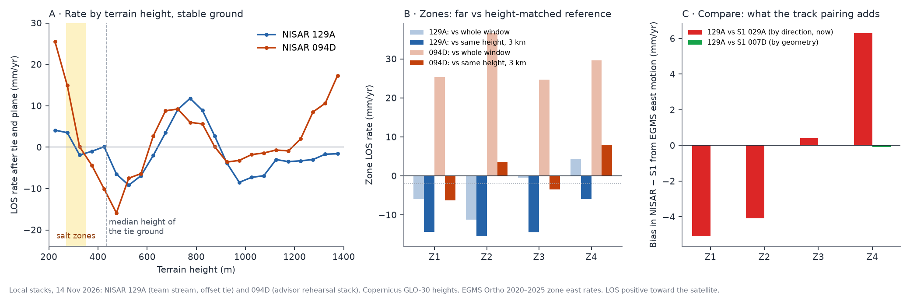

# Validation log (05, Paul)

**Owner:** 05 · Validator (Paul)

This is the hand-kept side of validation. `validate.py` writes the automatic checks to `products/<site>/checks.md`; this file records what the scripts cannot: station screening, HyP3 orders, red-team notes and the frozen-build re-run.

## Sentinel-1 orders (hyp3_order.py)

| When | Pairs (dates, geometry) | Jobs | Account | Status |
|---|---|---|---|---|
| Not needed so far | The main order (58 HyP3 burst pairs, 029A and 007D) was placed and fitted by 02/03, see `sentinel1/provenance/hyp3_jobs.json` | | | Extra Jan to Jun 2026 pairs stay a Tier 3 option |

## Station screening (before any station is trusted)

| Station | Network / source | Distance from the town | Monument (roof, mast, pillar?) | EGMS on its own building | Series ends | Use (held out / context) | Notes |
|---|---|---|---|---|---|---|---|
| VLC1 | NGL MIDAS; NGL daily tenv3 (IGS20) | 6.4 km from the window centre | Not checked yet | −0.2 mm/yr (median of 79 EGMS cells within 500 m, 2020 to 2025) | 2018-12 (1,048 days from 2012-08) | Held out; pin says "assumes steady motion since 2018" | Linear fit to the daily Up series: −1.0 mm/yr (2012 to 2018, IGS20 frame, not Eurasia-fixed; MIDAS is the number to use). Agrees with EGMS within about 1 mm/yr, but the periods do not overlap. Off the bowl, so it tests stable ground only |
| VLC2 | Muntean et al. 2026 | 6.4 km | Not checked yet | −0.2 mm/yr (same 79 cells as VLC1) | 2025 | | vertical still to be read from Table S3 (04). `common.PUBLISHED` gives VLC2 the same position as VLC1 (45.1074 N, 24.3664 E): check whether they share a building or a mast. Until that is confirmed, VLC1 and VLC2 count as one witness, not two (raised by 04, 14 Nov 2026) |
| HORE | NGL MIDAS + Muntean et al. 2026 | 24.5 km | Not checked yet | −0.3 mm/yr (71 cells within 500 m) | 2020-03 (821 days from 2012-10) | Held out; "assumes steady motion since 2020" | Its vertical rate comes from NGL MIDAS only (Muntean et al. 2026 Table S3 has no HORE), so it rests on one solution; the pin should say so (raised by 04, 14 Nov 2026). Daily Up fit −1.5 mm/yr (2012 to 2020). Agrees with EGMS within about 1.2 mm/yr; no time overlap |
| VLC3 | NGL daily tenv3 | 6.4 km | | | 2020-03 (181 days) | Not used | The Up series jumps by about 14 m: a re-installation or a coordinate change. Unusable without editing |
| STOL | NGL daily tenv3 | 70.5 km, outside the window and the EGMS tile | | No EGMS cells (outside tile E54N25) | 2026-10 (248 days in 2026) | Context only | The nearest open station with 2026 data. Up −4.4 mm/yr over 2020-12 to 2025-11, −0.9 mm/yr over its whole record (2017 to 2026): check for equipment changes before quoting it. Under a year of 2026 data is mostly seasonal motion, so it gives no 2026 rate |
| TIMA | NGL daily tenv3 | 91.3 km | | No EGMS cells | 2026-10 (246 days in 2026) | Context only | Up −0.6 mm/yr over 2020-12 to 2025-11, close to EGMS stable ground in our window (−0.5 mm/yr) but 91 km away |

Station list from the NGL station file (`https://geodesy.unr.edu/NGLStationPages/llh.out`, read 14 Nov 2026): 29 stations within 120 km of the town; only STOL and TIMA have data in 2026. No ROMPOS data was used.

## EGMS

`python egms_cut.py ocnele_mari` writes `data/work/ocnele_mari/refs/egms_up.csv` (lon, lat, v), `egms_east.csv` and `egms_meta.json`, and the figures `docs/figures/05_egms_up_rate.png` and `05_egms_zone_history.png`. The zips stay local in `data/egms/`.

| Tile | Period | Points in the window | Cut by | Notes |
|---|---|---|---|---|
| L3 Ortho Up and East–West, E54N25, release 2020_2025_1 (produced 28 Jul 2026) | 2020-12-09 to 2025-11-25, 303 epochs every 6 days | 28,921 cells of 100 m in the 50 × 50 km window | `egms_cut.py` (05), 14 Nov 2026 | Used instead of the 2020–2024 release named in the build spec, because 2020–2025 is newer and covers the same years plus 2025 (see `DECISIONS.md`). Down to 2025-11, so no overlap with NISAR's 2026 dates: it gives the bowl's history, not a 2026 check |

What EGMS shows per zone (`common.py` zones, cells whose centre is inside the circle; stable = outside the zones plus 3 km), checked 14 Nov 2026:

| Zone | Cells | Up, median | Up, fastest cell | Up, total 2020-12 to 2025-11 | East–West, median |
|---|---|---|---|---|---|
| z1 | 2 | −3.9 mm/yr | −4.3 mm/yr | −21 mm | −4.1 mm/yr |
| z2 | 5 | −2.5 mm/yr | −4.3 mm/yr | −9 mm | −3.3 mm/yr |
| z3 | 6 | −18.9 mm/yr | −22.6 mm/yr | −89 mm | +0.2 mm/yr |
| z4 | 10 | −3.1 mm/yr | −8.1 mm/yr | −15 mm | +4.9 mm/yr |
| stable | 27,972 | −0.5 mm/yr | | −3 mm | −0.1 mm/yr |

- **z3 is the bowl.** It sinks steadily, with no sign of slowing between 2020 and 2025. If that continues, NISAR and Sentinel-1 should see about −19 mm/yr there in 2026; much more means a new event or a processing error.
- z1, z2 and z4 hold only 2 to 10 cells each, so their medians are fragile. Several fast cells lie between z3 and z1 and just north of z1, outside every zone circle: 01 and 03 may want to check the zone positions against this map.
- What this cannot tell us: anything after 2025-11, motion inside 100 m cells, or north–south motion (the Ortho split assumes none). The cell uncertainties EGMS reports (0.0 to 0.1 mm/yr) are rounded and understate the real error.

### EGMS on the stable ground (05's half of T8; separate from 04's model swap)

Question: does EGMS agree that the ground the tie treats as stable really is stable? `egms_cut.py` (14 Nov 2026) uses the two areas defined in `docs/build-spec.md`, writes the numbers to `refs/egms_meta.json` (`stable_ground`) and the map to `docs/figures/05_egms_stable_ground.png`. Stations from `common.PUBLISHED` (VLC1 placed with VLC2); `refs/stations.csv` is used instead once it exists.

| Area | EGMS points | Median Up | Robust scatter | 5 to 95 % | Within ±1.5 mm/yr | Sinking ≥ 5 mm/yr |
|---|---|---|---|---|---|---|
| Tie area: outside zones + 3 km, more than 1 km from stations | 27,478 | −0.6 mm/yr | 0.9 mm/yr | −3.0 to +0.6 mm/yr | 79 % | 1.2 % |
| Check-6 set: \|v\| < 1.5 mm/yr, outside zones + 500 m | 22,864 | −0.4 mm/yr | 0.6 mm/yr | −1.3 to +0.6 mm/yr | 100 % (by definition) | 0 % |

- **The tie area is stable, with a small regional sink.** Median −0.6 mm/yr, close to what the EGMS GNSS model gives at the window centre (−0.8 mm/yr Up). So "stable" here means about −0.6 mm/yr, not 0; a tie to a GNSS model keeps that level, which is correct.
- **It is not clean everywhere.** 1.2 % of the tie area sinks 5 mm/yr or faster, in small patches. The ten largest are in `egms_meta.json`; the fastest is 10 cells at 45.193 N, 24.057 E (21.7 km north-west of the centre, about 7 km from HORE) at −19.6 mm/yr, and the nearest is 10 cells at 45.004 N, 24.299 E (9.3 km south) at −6.8 mm/yr. Their cause is not known.
- **Effect on the tie is small.** Dropping every cell sinking 5 mm/yr or faster moves the tie-area median from −0.60 to −0.50 mm/yr; the tie's own 3σ clipping (twice) moves the mean from −0.79 to −0.67 mm/yr and drops 832 of 27,478 points. Both shifts are 0.1 mm/yr, well under the 1.5 mm/yr EGMS check and the 1 mm/yr T8 limit. 04 may still want to mask the two nearest patches.
- **Still to do (check 6, when NISAR up exists):** NISAR up minus EGMS up on the check-6 set, median below 1.5 mm/yr in absolute value. The set is ready; it waits on `up_east.npz` (03).
- What this cannot tell us: EGMS ends in Nov 2025, so it shows the ground was stable then, not in 2026; and EGMS is itself calibrated to a GNSS model, so it shares that model's level.

## Third witness for 2026 (build spec § 05, hour 6 to 18)

Searched 14 Nov 2026 for GNSS or radar with 2026 dates over the town, other than NISAR:

| Candidate | 2026 coverage | Independent of NISAR? | Verdict |
|---|---|---|---|
| Open GNSS (NGL) | Only STOL (70 km) and TIMA (91 km) | Yes | Too far to test the bowl; context only |
| Sentinel-1, ASF catalogue (SLC) | 110 dates, 1 Jan to 10 Nov 2026: track 029A (S1A to Jun, S1C, S1D from Apr) and 007D | Yes | Already the second radar (D-004, check 8). The Jan to Jun 2026 scenes are unused so far and would cover NISAR's 129A gap |
| NISAR | 129A from 18 Jan, 094D from 20 Jun 2026; GUNW, GSLC, GCOV, RSLC and soil moisture | No (it is the data under test) | Listed only so the dates line up |

No open third witness inside the window has 2026 data. The honest statement for the page is that the 2026 bowl rate is checked against Sentinel-1 only, and against EGMS for its 2020 to 2025 history.

## T10: Sentinel-1 holds up (05 with 03)

Read from `sentinel1/analysis/summary.json` on 14 Nov 2026: the July to October fit, 16 dates and 29 pairs per track (029A 2026-07-07 to 10-05, 007D 2026-07-06 to 10-04). The January to October extension in the handoff is not in `summary.json` yet, so it is not tested here.

Rule (prompts/early-tests.md): a zone **passes** where the sign of its fitted change holds in all five runs (baseline, strict coherence, west reference, east reference, elevation correction) and the spread (largest minus smallest) is smaller than the baseline change. Otherwise it is "not testable" in the Agreement view. Values are the fitted change over the window (`window_fit_mm`), line of sight, mm, negative = away from the satellite, relative to the 3 to 6.5 km reference band.

| Track | Zone | Baseline | Strict coh. | West ref. | East ref. | Elev. corr. | Spread | Result | Why |
|---|---|---|---|---|---|---|---|---|---|
| 029A | z1 | −8.6 (21 px) | −6.0 (3 px) | −7.1 | −8.6 | −8.0 | 2.6 | **Pass** | Strict coherence keeps only 3 pixels |
| 029A | z2 | −6.8 (43 px) | −7.8 (26 px) | −6.0 | −6.8 | −6.4 | 1.8 | **Pass** | |
| 029A | z3 | no connected series | | | | | | Not testable | No pixel spans the dates |
| 029A | z4 | −7.5 (34 px) | −8.6 (6 px) | −6.9 | −8.0 | −2.8 | 5.8 | **Pass** (narrow) | The elevation correction removes about 60 % of the change |
| 007D | z1 | −5.2 (79 px) | +0.3 (2 px) | −4.0 | −6.1 | −6.0 | 6.3 | Not testable | Sign flips under strict coherence (2 pixels) |
| 007D | z2 | −1.4 (48 px) | −3.9 (2 px) | +0.3 | −2.3 | −2.5 | 4.2 | Not testable | Sign flips with the west reference; spread larger than the change |
| 007D | z3 | +0.2 (55 px) | −0.1 (3 px) | +1.6 | −1.0 | +3.4 | 4.4 | Not testable | No consistent sign |
| 007D | z4 | −3.5 (76 px) | −2.8 (33 px) | −2.2 | −4.4 | −2.0 | 2.4 | **Pass** | |

Closure (`fits.quality`): median absolute misclosure 1.6 mm (029A) and 1.3 mm (007D) over 14 triangles each, 95th percentile 9.4 mm and 6.2 mm. The 95th percentile is as large as the zone changes on 029A, so single pixels are noisy even where the zone medians hold.

**T10 result: PASS WITH NOTE.** Four zone and track combinations hold (029A z1, z2, z4; 007D z4); four are not testable (029A z3; 007D z1, z2, z3). z4 is the only zone that holds on both tracks, which agrees with the handoff's choice of z4 for the demo.

What this cannot tell us:
- The reference band moves too: the outer control drifts +3.9 mm (029A) and +3.3 mm (007D) over the window, so zone changes are relative, not absolute.
- The sensitivity runs share the same pairs and atmosphere, so a pass shows the result is not fragile to these choices; it does not prove it is ground motion.

**Red flag for the team (01, 03, 04): z3.** EGMS shows z3 as the fastest-sinking zone in 2020 to 2025 (median −18.9 mm/yr Up, 6 cells). If that continued, Sentinel-1 should see roughly −3 to −4 mm of line-of-sight change over the 90 days. It sees no connected series on 029A and about 0 mm (+0.2, no consistent sign) on 007D. Possible reasons: low coherence over the bowl, the motion stopped or slowed, or the zone circle sits off the moving cells. This is a finding to explain, not an error to tune away; it goes to the red team below.

### z3 investigation (05, 14 Nov 2026)

Done on the committed Sentinel-1 grids (`sentinel1/assets`, checksums verified) and `refs/egms_up.csv` / `egms_east.csv`, with `notebooks/05/z3_check.py`. Nothing in `sentinel1/` was changed.

1. **The zone is in the right place.** 6 of the 31 EGMS cells sinking faster than −10 mm/yr lie inside the z3 circle, 11 within 1 km. The centre of the fast cells within 1.5 km is 214 m from the z3 centre, inside its 300 m radius.
2. **What Sentinel-1 should see if 2020 to 2025 continued.** EGMS z3 cells move −18.9 mm/yr Up and +0.2 mm/yr east. Projected on each track's look vector (029A east −0.63, up 0.77; 007D east +0.64, up 0.76) that is −13.8 mm/yr on 029A and −16.4 mm/yr on 007D in line of sight, so about **−3.4 mm and −4.1 mm over the 90-day window**.
3. **029A cannot see z3: coherence loss.** 0 of 177 pixels inside the circle have a series, 3 % in the 300 to 600 m ring, 21 % at 600 to 1,000 m. None of the 11 fast EGMS cells has a Sentinel-1 value. Not testable, as T10 says.
4. **007D sees z3 but not the sinking.** 55 of 177 pixels (31 %) have a series. At the 10 fast EGMS cells it covers, Sentinel-1 reads +8.8 mm/yr (towards the satellite) where EGMS predicts −6.5 mm/yr. On stable EGMS cells 1.5 to 3 km away the two agree (+0.8 against −0.4 mm/yr, 113 cells). The zone median over 90 days is about 0 mm against an expected −4 mm.
5. **But the expected signal is at the noise level.** −4 mm over 90 days is smaller than 007D's 95th-percentile misclosure (6.2 mm) and inside the spread of its sensitivity runs (−1.0 to +3.4 mm). So the honest reading is "**not detected**", not "contradicted". Sentinel-1's July to October window cannot tell whether z3 kept sinking or stopped.
6. **Side finding on 029A (for 03).** Stable EGMS cells 1.5 to 3 km from z3 read −19.3 mm/yr on 029A where EGMS has them at about 0 (70 cells). Pixels around z3 read −33 to −42 mm/yr. A broad negative signal on the west side of town, from the reference band, the atmosphere or real motion, may inflate 029A's z1, z2 and z4 rates (−27 to −35 mm/yr) as well. 007D does not show it.

**What would settle it:** the January to October extension (49 dates per track, already processed by 02/03). Over 9 months EGMS predicts about −10 to −12 mm on z3, well above the noise. The handoff says no descending salt-zone pixel spans all 49 dates under the current connectivity rule, so 03 would need to relax it or use the new group-aware solver.

**Suggested wording for the page (01 decides):** "z3 sank about 19 mm a year from 2020 to 2025 (EGMS). Sentinel-1 cannot confirm 2026 here: the ascending track loses coherence over the bowl, and on the descending track the expected 4 mm over July to October is within the noise."

## Station misfit, 094D and the Compare pairing (14 Nov 2026, about 21:45)

Done by Alex with Claude Code, on Matei's session. Figure: [04_height_and_pairing.png](figures/04_height_and_pairing.png). UI before the fix: [ui-review-14nov/](figures/ui-review-14nov/).

**Which stacks:** the team stack behind the live page is not on this machine. These numbers use the two local stacks:
- NISAR 129A: the team's own stream, tied with one offset (−5.80 mm/yr).
- NISAR 094D: the advisor's rehearsal stack. It has the same T3 problem, with zones at +27.5 mm/yr.

Each conclusion below is about method, so it carries over to the team stack. Rerun `validate.py` where that stack lives to get the page's numbers.

### 1 · VLC1 and VLC2 "fail": the check cannot decide, it does not show a problem

| | Live page (plane tie) | Local 129A (offset tie) | GNSS in 129A LOS |
| --- | --- | --- | --- |
| NISAR at VLC1/VLC2 (7 × 7 box, 49 px) | **+3.9 mm/yr** | **−4.6 mm/yr** | VLC1 −0.6 · VLC2 +0.3 |
| Tolerance the check used | ±2.7 | | |
| Honest σ of one 7 × 7 box against the frame | | **26 mm/yr** (129A) · 37 (094D) | ±0.5 |

- **The tolerance is about ten times too tight.** The check divided the box scatter by √49, as if neighbouring pixels were independent. They are not: the noise (troposphere, short span) is correlated over kilometres. Sampled across all the stable ground, a 7 × 7 box median scatters by 26 mm/yr, about the same as a single pixel.
- **The tie method alone moves VLC by 8.5 mm/yr.** The page's 129A tie is a plane with an east slope of −12.0 mm/yr per 10 km. VLC lies 6 km east of the window centre, so it gets about −7 mm/yr more correction than the centre. That swing is twice the station misfit.
- **The terrain height does not explain it.** VLC is at 247 m, in the Olt valley. The height trend predicts −0.9 mm/yr there.
- **Fix in `validate.py`:**
  - σ_NISAR is now the measured spread of box medians on the tie ground.
  - A tolerance wider than 20 mm/yr gives **warn**, "neither confirms nor rejects the tie". That is the same rule check 8 already used.
  - VLC1 and VLC2 will read warn, not fail.
- **What would make the station test real:** many dates (a long stack averages the atmosphere down), or a station inside a coherent, corner-reflector-like target. Neither exists in 2026. The page should say the station check is not decisive yet.

### 2 · Compare pairing: pair by east sensitivity, not by direction (O-19 proposal)

| Track | Looks | e | n | u |
| --- | --- | --- | --- | --- |
| NISAR 129A ascending | left | **+0.624** | +0.207 | 0.753 |
| NISAR 094D descending | left | **−0.616** | +0.240 | 0.750 |
| Sentinel-1 029A ascending | right | **−0.636** | (dropped) | 0.764 |
| Sentinel-1 007D descending | right | **+0.640** | (dropped) | 0.760 |

Check 8 scales NISAR by the ratio of the up components and assumes no east-west motion. EGMS gives the zones east rates of −4.1, −3.3, +0.2 and +4.9 mm/yr (stable ground −0.1). The geometry alone therefore puts this into NISAR − Sentinel-1:

| Pairing | Z1 | Z2 | Z3 | Z4 |
| --- | --- | --- | --- | --- |
| 129A with 029A (by direction, what ran) | −5.1 | −4.1 | +0.4 | **+6.3** |
| **129A with 007D** (by geometry) | 0.0 | 0.0 | 0.0 | −0.1 |

- **Proposed default:** 129A with 007D, and 094D with 029A. Within each pair the east parts cancel to under 0.1 mm/yr, so "scale by the up ratio" becomes nearly exact.
- **Bonus:** 007D has 55 usable pixels in Zone 3, where 029A has none, so Zone 3 becomes testable.
- **Done in `validate.py`:** `S1_PAIR = {"129A": "007D", "094D": "029A"}`, and each Sentinel-1 track uses its own up component. Before this, both used 029A's, taken from `forecast.json`.
- **Still to do in the page:** the Compare default (`docs/ui.md` says "ascending with ascending"). Compare is disabled on the page "until O-19"; this pairing is the O-19 answer for 129A.

### 3 · NISAR 094D: the far reference measures the valley, not the zones

- **The valley floor is the signal.** On stable ground, 094D reads **+15 to +25 mm/yr below 300 m**, after the tie and a fitted plane. It drops to about −16 mm/yr at 475 m. The zones lie at 275 to 350 m, right on the valley floor. The tie ground's median height is 434 m.
- **A plane does not help.** The fitted plane barely changes the scatter (50.7 → 48.5 mm/yr) and leaves the zones where they were. The signal follows the terrain, not a ramp.
- **Neither does a straight line in height.** The rate rises and falls with height (panel A), so the per-pair linear troposphere slope in `stack.py` cannot remove it. 03's notebook measured −3.7 to +2.5 mm per 100 m, changing sign from pair to pair.
- **Against ground at the same height within 3 km**, the zones read:

| Track | Z1 | Z2 | Z3 | Z4 |
| --- | --- | --- | --- | --- |
| 094D | −6.3 | +3.6 | −3.5 | +8.0 |
| 129A (control) | −14.4 | −15.5 | −14.5 | −5.9 |

  - **094D:** mixed. The +23.5 mm/yr is gone, but there is no consistent sinking either.
  - **129A:** all four zones sink clearly.
- **Hypothesis, not tested:** 094D images at about 07:30 local time, when valleys hold morning temperature inversions and humid air pooled in the low ground. 129A images in the evening, when the boundary layer is mixed. A 0.25° weather model cannot resolve a 2 km valley, which fits 03's finding that the ECMWF correction made 094D worse (+43 mm/yr).
- **Conclusion:** do not flip 094D's phase sign. The +23.5 mm/yr comes from using a far reference, not from a sign error. Keep 094D off the page.
- **Fix in `validate.py`:** check 1 now also prints the height-matched zone values. The pass/fail rule is unchanged, because T3 was predeclared.

## Red team at hours 12 / 24 / 40 (with the advisor)

| Hour | Finding | Owner | Verdict (fix / cut / explain) |
|---|---|---|---|
| Before hour 12 (T10) | z3 is the fastest-sinking zone in EGMS 2020 to 2025 (−18.9 mm/yr) but Sentinel-1 shows no usable 2026 signal there (029A no series; 007D about 0 mm) | 03 with 05 | **Explain** (05 investigated, see "z3 investigation"): zone position is fine; 029A has no coherent pixels there; on 007D the expected 4 mm is within the noise. Ask 03 for the Jan to Oct extension on z3, and to look at 029A's negative bias around z3 |
| Before hour 12 | `sentinel1/scripts/restore_grids.py` refuses to run on Windows: git turns `summary.json` into CRLF line endings, so its SHA-256 no longer matches `MANIFEST.json` (the file in git is unchanged) | 03 | Fix: hash the file with `\r\n` turned back into `\n`, or add `sentinel1/analysis/summary.json -text` to a `.gitattributes` |

## Frozen-build re-run (hours 40–48)

| Check | Result on the frozen build | Same as before the freeze? |
|---|---|---|
| | | |

## Moisture and rainfall screen, and the forecast test (05, 14 Nov 2026)

### Predeclared before any Zone 4 result was looked at (written 14 Nov 2026, about 17:40)

One exogenous input is tested against the forecast baselines on `r06/page` (`sentinel1/scripts/forecast.py`, `products/ocnele_mari/forecast.json`):

- **Input:** ERA5 daily precipitation at 45.088 N, 24.290 E (Open-Meteo archive), summed over the **7 days ending on the acquisition date** (lag 0), in mm. Chosen because it exists for every date and needs no pixel support; NISAR's recommended soil-moisture retrievals do not cover Zone 4 (see the screen below).
- **Model:** at each cutoff, using only dates up to the cutoff: Theil–Sen slope as in `forecast.py`, then ridge regression of the detrended LOS on the standardised rain input (λ = 1, fixed, not tuned), with standardisation fitted inside the cutoff.
- **Issuance forecast (information available at the cutoff):** future rain is unknown, so the rain term is assumed to return to its training mean: forecast = last value + slope × lead + β × (training mean − rain at the cutoff).
- **Conditional scenario (labelled, not a forecast):** the same model given the observed rain at the target date.
- **Scoring:** the same four cutoffs and the 30-day lead as `forecast.json`, mean absolute error against the same observed values, next to persistence, Theil–Sen and the Matérn GP.
- **Pass:** the issuance forecast beats persistence (the best simple baseline, 4.19 mm) on the same cutoffs. Anything else is reported as no improvement.

### Results (14 Nov 2026, about 17:30)

**Sources and settings.**
- Radar: Sentinel-1 `sentinel1/analysis/summary.json`, baseline fit, tracks 029A (7 Jul to 5 Oct 2026) and 007D (6 Jul to 4 Oct), 16 dates each. LOS in mm, positive towards the satellite, relative to the 3 to 6.5 km reference band, first date = 0. Pixel support: z4 34 (029A) and 76 (007D); outer control ring (6.5 to 8 km) 14,963 and 12,153. The z4 029A series is the same one `forecast.json` uses (0, 1.2, 1.4 … −7.9 mm).
- Moisture: NISAR L3 SME2 provisional (beta for 18 Jan), 200 m EASE-Grid 2.0, m3/m3, read over HTTP with `notebooks/05/soil_moisture.py` (25 granules on tracks 129A and 094D, 7 Nov 2025 to 21 Oct 2026; 16 in July to early October). Footprint: the Sentinel-1 window, 16.4 km square on 45.088 N, 24.290 E. Area value = median of the pixels whose centre is in the area; zones widened by 100 m. "Recommended" = `retrievalQualityFlag` bit 0 = 0; "all" = every retrieval (sensitivity only).
- Pixel support in July to early October: reference band 493 to 797, control ring 200 to 330 (recommended); **z4 0 recommended on 15 of 16 dates (1 pixel on 6 Oct), 10 with all retrievals; z3 0 recommended, 13 with all**. Reference-band moisture ranged 17.7 to 28.2 %.
- Matching: each Sentinel-1 date takes the NISAR date at most 2 days away; every July to September Sentinel-1 date found one 1 day off. Lag 1 = the NISAR date before it (3 to 9 days earlier). Missing values are written as "missing" and left out of each correlation.
- Rain: ERA5 daily precipitation (Open-Meteo archive, 45.088 N 24.290 E), sums over 7 and 30 days ending on the Sentinel-1 date. July 49 mm, August 30 mm, September 4 mm, October 47 mm.
- Scripts: `notebooks/05/soil_moisture.py`, `notebooks/05/z4_screen.py` (this section), `notebooks/05/sm_vs_s1.py` (all zones; figure `docs/figures/05_soil_moisture_vs_s1.png`). Local outputs (git-ignored): `data/work/ocnele_mari/sm/sm_zones.csv`, `rain_era5_daily.csv`, `z4_screen.json`.

**Date-aligned inputs, Zone 4 and the control ring.**

**029A** (Sentinel-1 pixels: z4 34, control 14963). LOS in mm; moisture = area minus reference band, in percentage points (pixels in brackets); lag1 = previous NISAR date; rain in mm.

| S1 date | NISAR date (track) | z4 LOS | z4 moisture rec | z4 moisture all | z4 lag1 all | control LOS | control moisture rec | control lag1 rec | rain 7 d | rain 30 d |
|---|---|---|---|---|---|---|---|---|---|---|
| 2026-07-07 | 2026-07-05 (129A) | 0.0 | missing (0) | 1.7 (10) | -1.7 | 0.0 | -0.6 (202) | 0.2 | 11.9 | 55.5 |
| 2026-07-13 | 2026-07-14 (094D) | 1.2 | missing (0) | -0.1 (10) | 1.7 | 0.1 | -0.8 (210) | -0.6 | 5.4 | 43.4 |
| 2026-07-19 | 2026-07-17 (129A) | 1.4 | missing (0) | 0.6 (10) | -0.1 | -1.2 | -0.1 (210) | -0.8 | 10.6 | 43.4 |
| 2026-07-25 | 2026-07-26 (094D) | -6.6 | missing (0) | -0.6 (10) | 0.6 | 3.0 | 0.7 (209) | -0.1 | 28.0 | 49.6 |
| 2026-07-31 | none within 2 d | -2.2 | missing (0) | missing (0) | missing | 0.4 | missing (0) | missing | 0.4 | 43.9 |
| 2026-08-06 | none within 2 d | 4.5 | missing (0) | missing (0) | missing | -6.8 | missing (0) | missing | 1.6 | 38.8 |
| 2026-08-12 | 2026-08-10 (129A) | 19.9 | missing (0) | 2.6 (10) | -0.6 | -9.7 | 0.1 (216) | 0.7 | 7.6 | 41.2 |
| 2026-08-18 | 2026-08-19 (094D) | -2.7 | missing (0) | 0.9 (10) | 2.6 | 2.7 | 0.1 (224) | 0.1 | 1.4 | 31.1 |
| 2026-08-24 | 2026-08-22 (129A) | -7.8 | missing (0) | 2.3 (10) | 0.9 | 1.1 | 0.8 (230) | 0.1 | 0.5 | 8.5 |
| 2026-08-30 | 2026-08-31 (094D) | -4.8 | missing (0) | -0.7 (10) | 2.3 | -2.4 | 0.8 (251) | 0.8 | 22.0 | 30.0 |
| 2026-09-05 | 2026-09-03 (129A) | -1.0 | missing (0) | 1.6 (10) | -0.7 | 2.4 | 1.3 (259) | 0.8 | 0.4 | 28.8 |
| 2026-09-11 | 2026-09-12 (094D) | -3.5 | missing (0) | -0.7 (10) | 1.6 | 5.3 | 0.4 (276) | 1.3 | 0.0 | 22.8 |
| 2026-09-17 | 2026-09-15 (129A) | -6.3 | missing (0) | 1.8 (10) | -0.7 | 4.2 | 0.2 (286) | 0.4 | 3.1 | 25.9 |
| 2026-09-23 | 2026-09-24 (094D) | -1.4 | missing (0) | 0.4 (10) | 1.8 | -2.9 | 0.1 (296) | 0.2 | 0.8 | 26.2 |
| 2026-09-29 | 2026-09-27 (129A) | -4.9 | missing (0) | 1.2 (10) | 0.4 | 1.8 | 0.4 (298) | 0.1 | 0.1 | 4.3 |
| 2026-10-05 | 2026-10-06 (094D) | -7.9 | 3.4 (1) | 0.5 (10) | 1.2 | 4.2 | 0.3 (327) | 0.4 | 0.0 | 3.9 |

**007D** (Sentinel-1 pixels: z4 76, control 12153). LOS in mm; moisture = area minus reference band, in percentage points (pixels in brackets); lag1 = previous NISAR date; rain in mm.

| S1 date | NISAR date (track) | z4 LOS | z4 moisture rec | z4 moisture all | z4 lag1 all | control LOS | control moisture rec | control lag1 rec | rain 7 d | rain 30 d |
|---|---|---|---|---|---|---|---|---|---|---|
| 2026-07-06 | 2026-07-05 (129A) | 0.0 | missing (0) | 1.7 (10) | -1.7 | 0.0 | -0.6 (202) | 0.2 | 10.3 | 55.5 |
| 2026-07-12 | 2026-07-14 (094D) | 1.5 | missing (0) | -0.1 (10) | 1.7 | 3.5 | -0.8 (210) | -0.6 | 5.5 | 44.2 |
| 2026-07-18 | 2026-07-17 (129A) | -0.5 | missing (0) | 0.6 (10) | -0.1 | 1.0 | -0.1 (210) | -0.8 | 6.8 | 38.5 |
| 2026-07-24 | 2026-07-26 (094D) | -3.5 | missing (0) | -0.6 (10) | 0.6 | 3.8 | 0.7 (209) | -0.1 | 29.3 | 50.0 |
| 2026-07-30 | none within 2 d | -0.6 | missing (0) | missing (0) | missing | 0.9 | missing (0) | missing | 0.5 | 49.1 |
| 2026-08-05 | none within 2 d | 4.7 | missing (0) | missing (0) | missing | -5.9 | missing (0) | missing | 0.0 | 39.0 |
| 2026-08-11 | 2026-08-10 (129A) | -1.3 | missing (0) | 2.6 (10) | -0.6 | 3.7 | 0.1 (216) | 0.7 | 6.2 | 40.3 |
| 2026-08-17 | 2026-08-19 (094D) | -1.1 | missing (0) | 0.9 (10) | 2.6 | 2.0 | 0.1 (224) | 0.1 | 1.4 | 36.0 |
| 2026-08-23 | 2026-08-22 (129A) | -6.2 | missing (0) | 2.3 (10) | 0.9 | 3.6 | 0.8 (230) | 0.1 | 0.4 | 8.4 |
| 2026-08-29 | 2026-08-31 (094D) | 3.6 | missing (0) | -0.7 (10) | 2.3 | 0.2 | 0.8 (251) | 0.8 | 22.0 | 30.0 |
| 2026-09-04 | 2026-09-03 (129A) | 0.9 | missing (0) | 1.6 (10) | -0.7 | 1.7 | 1.3 (259) | 0.8 | 0.4 | 30.4 |
| 2026-09-10 | 2026-09-12 (094D) | -2.6 | missing (0) | -0.7 (10) | 1.6 | 2.5 | 0.4 (276) | 1.3 | 0.0 | 24.2 |
| 2026-09-16 | 2026-09-15 (129A) | -3.4 | missing (0) | 1.8 (10) | -0.7 | 4.4 | 0.2 (286) | 0.4 | 3.1 | 25.9 |
| 2026-09-22 | 2026-09-24 (094D) | -1.8 | missing (0) | 0.4 (10) | 1.8 | 2.5 | 0.1 (296) | 0.2 | 0.7 | 26.2 |

**Screen.** r needed = |r| for p < 0.05 with that n. "Leaving one date out" gives the range of the detrended r when each date in turn is dropped (needed with one fewer date: about 0.55).
| 2026-09-28 | 2026-09-27 (129A) | -4.2 | missing (0) | 1.2 (10) | 0.4 | 2.7 | 0.4 (298) | 0.1 | 0.1 | 4.3 |
| 2026-10-04 | 2026-10-06 (094D) | -3.3 | 3.4 (1) | 0.5 (10) | 1.2 | 6.6 | 0.3 (327) | 0.4 | 0.0 | 3.9 |

| Track | Area | Input | n | r raw | r detrended | needed | r leaving one date out | Verdict |
|---|---|---|---|---|---|---|---|---|
| 029A | z4 | moisture, recommended | 1 | | | | | not testable (fewer than 5 dates with both values) |
| 029A | z4 | moisture, all retrievals | 14 | 0.39 | 0.42 | 0.53 | -0.04 to 0.58 | no flag |
| 029A | z4 | moisture lag 1, recommended | 0 | | | | | not testable (fewer than 5 dates with both values) |
| 029A | z4 | moisture lag 1, all retrievals | 14 | -0.31 | -0.23 | 0.53 | -0.33 to -0.02 | no flag |
| 029A | z4 | rain 7 d | 16 | -0.01 | -0.19 | 0.5 | -0.43 to 0.02 | no flag |
| 029A | z4 | rain 30 d | 16 | 0.46 | 0.16 | 0.5 | 0.07 to 0.21 | no flag |
| 029A | control | moisture, recommended | 14 | 0.21 | 0.08 | 0.53 | -0.04 to 0.15 | no flag |
| 029A | control | moisture, all retrievals | 14 | 0.45 | 0.43 | 0.53 | -0.07 to 0.57 | no flag |
| 029A | control | moisture lag 1, recommended | 14 | 0.06 | -0.08 | 0.53 | -0.29 to 0.23 | no flag |
| 029A | control | moisture lag 1, all retrievals | 14 | -0.21 | -0.2 | 0.53 | -0.39 to -0.07 | no flag |
| 029A | control | rain 7 d | 16 | -0.12 | 0.02 | 0.5 | -0.23 to 0.16 | no flag |
| 029A | control | rain 30 d | 16 | -0.36 | -0.1 | 0.5 | -0.14 to -0.04 | no flag |
| 007D | z4 | moisture, recommended | 1 | | | | | not testable (fewer than 5 dates with both values) |
| 007D | z4 | moisture, all retrievals | 14 | -0.32 | -0.34 | 0.53 | -0.55 to -0.1 | no flag |
| 007D | z4 | moisture lag 1, recommended | 0 | | | | | not testable (fewer than 5 dates with both values) |
| 007D | z4 | moisture lag 1, all retrievals | 14 | 0.1 | 0.2 | 0.53 | -0.02 to 0.36 | no flag |
| 007D | z4 | rain 7 d | 16 | 0.14 | -0.01 | 0.5 | -0.4 to 0.37 | no flag |
| 007D | z4 | rain 30 d | 16 | 0.52 | 0.2 | 0.5 | 0.02 to 0.27 | no flag |
| 007D | control | moisture, recommended | 14 | 0.05 | -0.18 | 0.53 | -0.34 to -0.06 | no flag |
| 007D | control | moisture, all retrievals | 14 | -0.06 | -0.13 | 0.53 | -0.26 to 0.04 | no flag |
| 007D | control | moisture lag 1, recommended | 14 | 0.0 | -0.24 | 0.53 | -0.37 to -0.15 | no flag |
| 007D | control | moisture lag 1, all retrievals | 14 | -0.41 | -0.44 | 0.53 | -0.62 to -0.34 | no flag |
| 007D | control | rain 7 d | 16 | 0.01 | 0.18 | 0.5 | -0.02 to 0.37 | no flag |
| 007D | control | rain 30 d | 16 | -0.41 | -0.09 | 0.5 | -0.14 to -0.04 | no flag |

**What the screen says.**
- **No input is flagged for Zone 4 or the control ring, on either track.** The largest detrended values are 0.42 (029A z4, all-retrieval moisture; 0.58 with one date removed, −0.04 with another) and −0.44 (007D control, lag-1 all-retrieval moisture; −0.62 with one date removed). Both depend on single dates.
- **Zone 4 cannot be screened with NISAR's recommended moisture:** no recommended retrieval falls in it. The all-retrieval values are a sensitivity test on 10 pixels NISAR itself does not recommend.
- **Rain** shows no detrended link anywhere. Its raw 30-day r reaches 0.46 to 0.52, but that disappears after removing the trend: the wet July and dry September line up with the summer trend, not with the wiggles.
- **Other zones (from `sm_vs_s1.py`, same method, recommended retrievals):** 029A z1 r = −0.70 with moisture (needed 0.53; about −2.4 mm per percentage point), 029A z2 −0.48, 007D z1 −0.51 and +0.55 at lag 1, 007D z2 −0.42. With 4 zones × 2 tracks × several inputs tried, one value past 0.53 is about what chance gives; z1 and z2 also share pixels. Treat 029A z1 as a candidate to recheck on the January to October extension, not a finding.

**Forecast test (predeclared 7-day rain, Zone 4, 029A).** Same four cutoffs as `forecast.json` (18 Aug, 24 Aug, 30 Aug, 5 Sep 2026), MAE at the 30-day lead against the same observed values.

| Model | MAE at 30 days |
|---|---|
| Persistence (export / reproduced) | 4.19 / 4.19 mm |
| Theil–Sen (export / reproduced) | 5.53 / 5.44 mm |
| Matérn GP (export / reproduced) | 3.95 / 3.90 mm |
| **Theil–Sen + 7-day rain, issuance** (only information at the cutoff) | **4.74 mm** |
| Theil–Sen + 7-day rain, conditional on the observed future rain (scenario, not a forecast) | 5.42 mm |

- **Result: no improvement.** The issuance forecast (4.74 mm) does not beat persistence (4.19 mm), so by the predeclared rule the rain input fails. It helps relative to Theil–Sen alone (5.44 mm) on 3 of 4 cutoffs, but the GP is better still (3.90 mm). Knowing the future rain makes it worse (5.42 mm), which argues against a real rain effect.
- The fitted rain coefficient was −1.2 to −1.6 mm per standard deviation of 7-day rain at every cutoff (wetter week, slightly more "away"), consistent in sign but small next to the 3 to 6 mm scatter of the folds.
- **Difference from `forecast.py`:** it rebuilds the training series from the raw pairs at each cutoff (no pair after the cutoff); the raw ZIPs are not on this machine, so the training series here is the final reconstruction truncated at the cutoff. The reproduced baseline MAEs differ from the export by at most 0.09 mm, so the approximation does not change the ranking, but a small look-ahead remains. 03 can rerun the test inside `forecast.py` if this ever matters.
- With 4 overlapping cutoffs and no prediction interval, none of these MAE differences is significant.

**Verdict.** Neither soil moisture nor rain explains the Zone 4 summer signal on the evidence available, and rain does not improve the 30-day forecast. The honest limits: Zone 4 has no recommended moisture retrievals, the summer series has 14 to 16 dates, and the backtest has 4 overlapping cutoffs.

## Closure against soil-moisture change (05, idea 2)

### Predeclared before any closure was computed (14 Nov 2026, about 17:55)

- **Closure:** for every triangle of dates i < j < k with all three pairs among the 58 HyP3 products, d_ij + d_jk − d_ik per pixel (mm, LOS), with `fit.py`'s baseline masks (coherence ≥ 0.35, connected component, water, main component of the reference band, each pair zeroed on the 3 to 6.5 km band). Script: `notebooks/05/closure_moisture.py`, reading the ZIPs from `sentinel1/scripts/download.py`.
- **Moisture input:** the range (largest minus smallest) of NISAR SME2 recommended moisture across the triangle's three dates, matched within 2 days; the area's own value where it has at least 3 pixels on all three dates, else the whole 16.4 km window.
- **Test:** Spearman ρ between the median |closure| of an area and that moisture range, per track and both pooled, for each zone, the reference band, the control ring and the whole window. Flag: p < 0.05 on the pooled whole window or control ring (the areas with real moisture support). Zone results are reported but, with 1 to 8 moisture pixels, not used for the flag.

### Results (14 Nov 2026, about 18:00)

- **Inputs:** the 58 HyP3 ZIPs from `sentinel1/scripts/download.py` (all 58 SHA-256 checksums verified), read with rasterio onto `fit.py`'s 40 m grid. 14 triangles per track, as in `summary.json`. The per-triangle median |closure| over the window (1.7 mm on 029A, 1.3 mm on 007D) matches the order of `summary.json`'s pixel median (1.6 and 1.3 mm), so the computation reproduces the fit's quality numbers.
- **Matching:** 10 of 14 triangles per track have moisture on all three dates. The 4 missing ones per track (late July to mid August) fall in NISAR's 26 Jul to 10 Aug gap. Moisture ranges across a triangle: 1.0 to 6.5 percentage points (window, band, control), up to 9.2 in z1 and z2.
- Outputs: `notebooks/05/closure_moisture.csv` (one row per triangle and area: pixels, median |closure| and signed median in mm, moisture range and its source) and `closure_moisture.json`; figure `docs/figures/05_closure_vs_moisture.png`.

| Area | Moisture from | n (both tracks) | Spearman ρ | p | median \|closure\| |
|---|---|---|---|---|---|
| Whole window | window | 20 | +0.19 | 0.42 | 1.24 mm |
| Control ring | control | 20 | +0.26 | 0.27 | 1.17 mm |
| Reference band | band | 20 | +0.13 | 0.58 | 1.16 mm |
| z1 | z1 | 20 | +0.04 | 0.86 | 2.01 mm |
| z2 | z2 | 20 | −0.14 | 0.55 | 1.54 mm |
| z3 | window (no zone support) | 17 | +0.10 | 0.69 | 2.21 mm |
| z4 | window (no zone support) | 19 | +0.19 | 0.44 | 1.69 mm |

Per track the values are similar (window ρ +0.26 on 029A, +0.15 on 007D; control +0.37 and +0.15; all p > 0.25); the full list is in the JSON.

**Verdict: no flag.** By the predeclared rule (p < 0.05 on the pooled window or control ring) closure does not follow soil-moisture change in this summer stack. The signs on the well-supported areas are weakly positive (a bigger moisture swing goes with a slightly larger misclosure), as moisture-phase theory predicts, but 20 triangles cannot separate that from chance. Closure is larger inside the zones (1.5 to 2.2 mm) than on the band and control (about 1.2 mm), and that difference is not explained by moisture either; fewer coherent pixels and steeper phase in the zones are the likelier reasons.

What it cannot tell us: moisture over a triangle is three 200 m snapshots matched within 2 days, not the moisture at the radar overpass; NISAR misses the late July to mid August triangles; and summer 2026 had only modest moisture swings (at most about 6.5 points over the window). The January to October extension, with winter moisture changes, is the stronger test.
